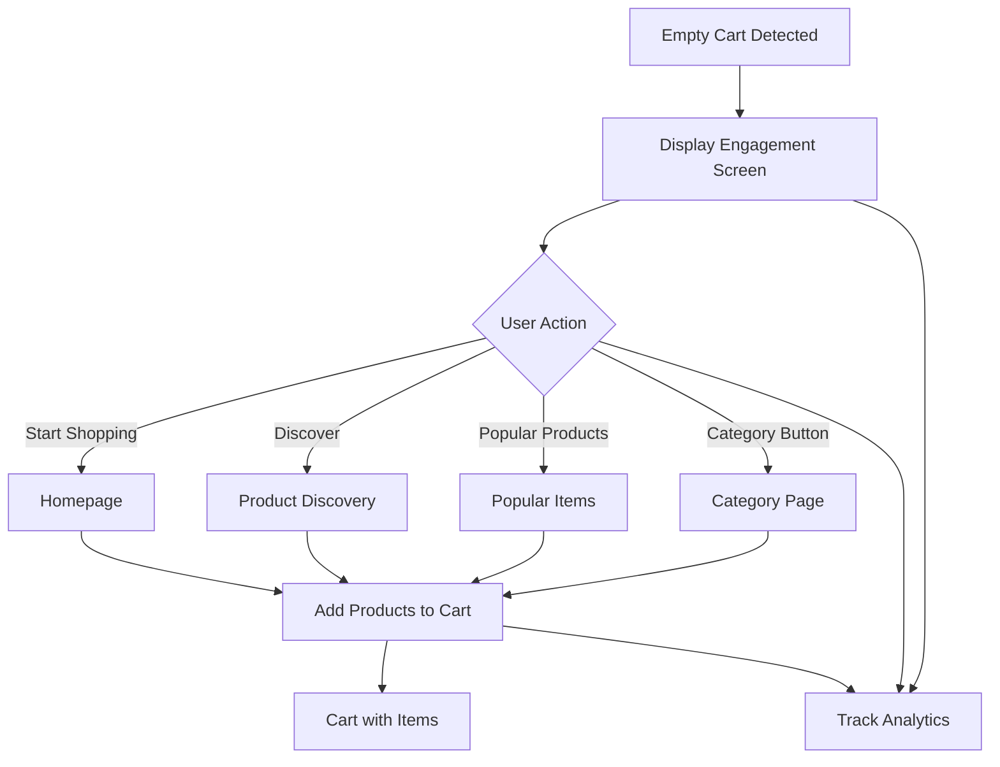

# Empty Cart Engagement Screen - Product Requirements Document

## 1. Product Overview

The empty cart engagement screen transforms a potentially negative user experience (empty shopping cart) into a motivational shopping opportunity. Instead of showing a simple "Your cart is empty" message, this screen will actively encourage users to start shopping with compelling visuals, strategic CTAs, and personalized content recommendations.

This feature aims to reduce cart abandonment rates, increase user engagement, and drive conversion by providing clear pathways back to product discovery and purchase.

## 2. Core Features

### 2.1 User Roles

| Role | Registration Method | Core Permissions |
|------|---------------------|------------------|
| Guest User | No registration required | Browse products, add to cart, view empty cart engagement |
| Authenticated User | Email registration | Full shopping experience, personalized recommendations, saved cart functionality |

### 2.2 Feature Module

The empty cart engagement consists of the following main components:

1. **Motivational Header Section**: Engaging headline, supportive subtitle, and appealing visual elements
2. **Product Discovery CTAs**: Strategic call-to-action buttons directing to different product categories
3. **Recommendation Showcase**: Featured categories and popular products section
4. **Visual Design Elements**: Color psychology-based design with engaging illustrations
5. **Analytics Integration**: Comprehensive tracking for conversion optimization

### 2.3 Page Details

| Page Name | Module Name | Feature description |
|-----------|-------------|---------------------|
| Empty Cart Engagement | Motivational Header | Display "Start Shopping!" headline with supportive subtitle and engaging background illustration |
| Empty Cart Engagement | Primary CTA Button | Large "Start Shopping" button with prominent styling and smooth hover animations |
| Empty Cart Engagement | Secondary CTAs | "Discover", "Popular Products", and "Deals" buttons with category-specific navigation |
| Empty Cart Engagement | Category Navigation | Quick access buttons to main food categories (Chicken, Sides, Drinks, Desserts) |
| Empty Cart Engagement | Featured Products | Showcase 3-4 popular items with images, names, and quick-add functionality |
| Empty Cart Engagement | Visual Elements | Background pattern, shopping icons, and color-coded sections based on color psychology |
| Empty Cart Engagement | Responsive Design | Mobile-first design with touch-optimized buttons and swipeable content |
| Empty Cart Engagement | Animation Effects | Subtle fade-in animations and smooth transitions between states |

## 3. Core Process

### User Flow
1. User navigates to cart page when cart is empty
2. System detects empty cart state and displays engagement screen
3. User sees motivational header with engaging visuals
4. User can choose from multiple CTA options:
   - Start Shopping (main CTA) → Homepage
   - Discover → Product discovery page
   - Popular Products → Popular items section
   - Category buttons → Specific category pages
5. Analytics track user interactions and conversion paths
6. User navigates to selected destination and begins shopping

### Analytics Flow
1. Track empty cart view events
2. Monitor CTA click rates and button performance
3. Measure conversion from empty cart to product pages
4. Analyze user behavior patterns and A/B test results

## 4. User Interface Design

### 4.1 Design Style

**Color Psychology-Based Palette:**
- Primary: Warm orange (#FF6B35) - Stimulates appetite and creates urgency
- Secondary: Fresh green (#4CAF50) - Suggests freshness and health
- Accent: Golden yellow (#FFC107) - Creates optimism and energy
- Background: Soft cream (#FFF8F3) - Warm and inviting
- Text: Deep charcoal (#2C3E50) - Professional and readable

**Typography:**
- Headings: Poppins font, bold weights (600-700)
- Body text: Roboto font, regular weight (400)
- CTA buttons: Poppins font, medium weight (500)

**Visual Elements:**
- Rounded corners (8-12px) for friendly appearance
- Subtle shadows for depth and hierarchy
- Food-related icons and illustrations
- Smooth animations (200-300ms transitions)

**Layout Principles:**
- Mobile-first responsive design
- Touch-friendly button sizes (min 44px height)
- Clear visual hierarchy with proper spacing
- Accessible color contrast ratios

### 4.2 Component Specifications

**Motivational Header:**
- Headline: "Start Shopping!" (28-32px mobile, 36-42px desktop)
- Subtitle: "Discover delicious meals waiting for you" (16-18px)
- Background: Subtle pattern or food illustration
- Padding: 24px mobile, 32px desktop

**Primary CTA Button:**
- Text: "Start Shopping" (18px font size)
- Size: Full width mobile, 280px desktop
- Color: Primary orange with white text
- Hover: 10% darker shade with scale animation
- Icon: Shopping bag or arrow right

**Secondary CTAs:**
- Layout: Grid layout (2x2 mobile, 4x1 desktop)
- Size: Equal width buttons
- Colors: Secondary green, accent yellow
- Icons: Relevant category icons

**Category Navigation:**
- Chicken Category: Orange accent, chicken icon
- Sides Category: Green accent, sides icon
- Drinks Category: Blue accent, drink icon
- Desserts Category: Pink accent, dessert icon

### 4.3 Responsiveness

**Mobile (320px - 768px):**
- Single column layout
- Full-width buttons for easy touch
- Larger touch targets (minimum 44px)
- Swipeable content sections
- Collapsible elements for space efficiency

**Tablet (768px - 1024px):**
- Two-column grid for CTAs
- Medium-sized buttons and text
- Balanced spacing and proportions

**Desktop (1024px+):**
- Multi-column layouts
- Maximum content width of 1200px
- Hover effects and animations
- Enhanced visual elements

## 5. Technical Requirements

### 5.1 Implementation Specifications

**Component Architecture:**
- Create new `EmptyCartEngagement` React component
- Integrate with existing CartPage.tsx
- Use existing design system (Tailwind + shadcn/ui)
- Follow wrapper pattern for page integration

**State Management:**
- Use existing CartContext for cart state detection
- No additional state management required
- Analytics tracking through existing systems

**Navigation:**
- Use existing routing system
- Maintain browser history for back navigation
- Preserve query parameters and filters

**Performance:**
- Lazy load engagement assets
- Optimize images for different screen sizes
- Implement smooth CSS transitions

### 5.2 Analytics Integration

**Event Tracking:**
- `empty_cart_viewed` - When engagement screen is displayed
- `empty_cart_cta_clicked` - CTA button interactions
- `empty_cart_conversion` - Successful navigation to products
- `empty_cart_time_spent` - Time spent on engagement screen

**Metrics to Monitor:**
- View-to-click conversion rates
- Button performance comparison
- User journey completion rates
- A/B test variant performance

**A/B Testing Framework:**
- Support for multiple headline variants
- Button color and text testing
- Layout and positioning experiments
- Content variation testing

### 5.3 Accessibility Requirements

**WCAG 2.1 Compliance:**
- Proper heading hierarchy (H1, H2, H3)
- Sufficient color contrast ratios (4.5:1 minimum)
- Keyboard navigation support
- Screen reader compatibility
- Focus indicators on interactive elements

**Mobile Accessibility:**
- Touch target size minimum 44x44px
- Proper spacing between interactive elements
- Clear visual feedback for interactions
- Support for assistive technologies

## 6. Success Metrics

### 6.1 Primary KPIs

**Conversion Rate:**
- Target: 25% of empty cart views result in product page visits
- Baseline: Current 5% with simple empty message
- Measurement: Google Analytics or similar tracking

**Engagement Rate:**
- Target: 40% of users interact with at least one CTA
- Baseline: Current 10% with existing design
- Measurement: Click tracking and heat maps

**Revenue Impact:**
- Target: 15% increase in cart additions from empty state
- Baseline: Current conversion funnel performance
- Measurement: E-commerce tracking and sales data

### 6.2 Secondary Metrics

**User Experience:**
- Time spent on empty cart page
- Bounce rate reduction
- User satisfaction surveys
- Support ticket reduction

**Technical Performance:**
- Page load time impact
- Mobile performance scores
- Cross-browser compatibility
- Animation smoothness

## 7. Future Enhancements

### 7.1 Personalization Features

**User-Based Recommendations:**
- Personalized product suggestions
- Category preferences based on history
- Time-based recommendations (breakfast, lunch, dinner)
- Seasonal and promotional content

**Dynamic Content:**
- Real-time inventory-based suggestions
- Location-based restaurant recommendations
- Weather-appropriate food suggestions
- Special dietary preference filtering

### 7.2 Advanced Analytics

**Behavioral Analysis:**
- User segment performance tracking
- Conversion funnel optimization
- Multi-variant testing capabilities
- Predictive analytics for user behavior

**Business Intelligence:**
- Revenue attribution modeling
- Customer lifetime value impact
- Seasonal trend analysis
- Competitive benchmarking

## 8. Implementation Timeline

**Phase 1 (Week 1-2):** Basic engagement screen with motivational design
**Phase 2 (Week 3-4):** CTA implementation and navigation integration
**Phase 3 (Week 5-6):** Analytics setup and A/B testing framework
**Phase 4 (Week 7-8):** Performance optimization and accessibility testing
**Phase 5 (Week 9-10):** User testing and iteration based on feedback

This comprehensive PRD provides the foundation for creating an effective empty cart engagement screen that transforms a potential user experience issue into a conversion opportunity.