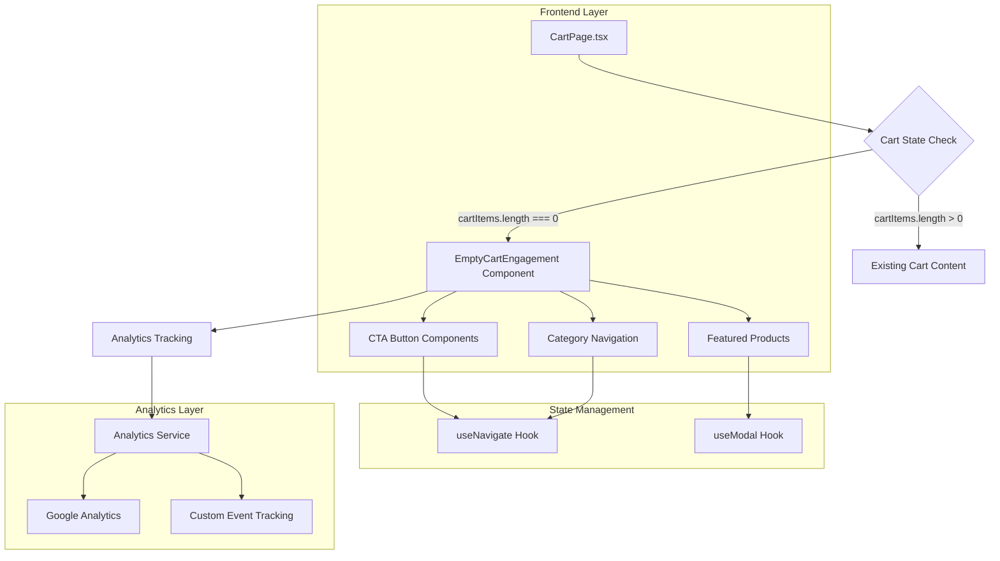

# Empty Cart Engagement Screen - Technical Architecture Document

## 1. Architecture Design



## 2. Technology Description

**Frontend Stack:**
- React@18 with TypeScript
- Tailwind CSS@3 for styling
- shadcn/ui components for UI consistency
- Lucide React for icons
- Vite for build tooling

**State Management:**
- React Context API (existing CartContext)
- React Router DOM for navigation
- Custom hooks for analytics tracking

**Analytics & Tracking:**
- Google Analytics 4 integration
- Custom event tracking system
- A/B testing framework support

**Development Tools:**
- TypeScript for type safety
- ESLint for code quality
- Prettier for code formatting

## 3. Component Architecture

### 3.1 Main Components

**EmptyCartEngagement.tsx** (Main Component)
```typescript
interface EmptyCartEngagementProps {
  onCtaClick?: (action: string) => void;
}

const EmptyCartEngagement: React.FC<EmptyCartEngagementProps> = ({ onCtaClick }) => {
  // Component logic with analytics tracking
  // Responsive layout with mobile-first design
  // CTA button handlers and navigation
}
```

**EngagementCTAButton.tsx** (Reusable CTA Component)
```typescript
interface EngagementCTAButtonProps {
  variant: 'primary' | 'secondary' | 'category';
  text: string;
  icon?: React.ReactNode;
  onClick: () => void;
  fullWidth?: boolean;
  analyticsLabel: string;
}
```

**CategoryButton.tsx** (Category Navigation)
```typescript
interface CategoryButtonProps {
  category: CategoryType;
  onClick: (category: CategoryType) => void;
  isMobile?: boolean;
}
```

### 3.2 Route Definitions

| Route | Purpose | Component |
|-------|---------|-----------|
| /cart | Main cart page | CartPage.tsx |
| /home | Homepage navigation | HomePageWrapper.tsx |
| /category/:id | Category pages | CategoryPageWrapper.tsx |
| /popular | Popular products | PopularProductsWrapper.tsx |
| /deals | Deals and promotions | DealsPageWrapper.tsx |

### 3.3 Integration Points

**CartPage.tsx Modification:**
```typescript
// Existing empty state replacement
{cartItems.length === 0 ? (
  <EmptyCartEngagement 
    onCtaClick={handleEngagementCtaClick}
  />
) : (
  // Existing cart content
)}
```

## 4. Analytics Integration

### 4.1 Event Tracking Types

```typescript
interface EmptyCartAnalyticsEvent {
  event: 'empty_cart_viewed' | 'empty_cart_cta_clicked' | 'empty_cart_conversion';
  properties: {
    timestamp: number;
    userId?: string;
    sessionId: string;
    ctaLabel?: string;
    destination?: string;
    timeSpent?: number;
  };
}
```

### 4.2 Analytics Implementation

**useEmptyCartAnalytics Hook:**
```typescript
export const useEmptyCartAnalytics = () => {
  const trackEvent = (event: string, properties: Record<string, any>) => {
    // Google Analytics 4 tracking
    gtag('event', event, properties);
    
    // Custom analytics service
    analyticsService.track(event, properties);
  };
  
  return { trackEvent };
};
```

### 4.3 A/B Testing Framework

**Variant Management:**
```typescript
interface ABTestVariant {
  id: string;
  headline: string;
  primaryCTA: string;
  buttonColor: string;
  layout: 'grid' | 'list';
}

const abTestVariants: Record<string, ABTestVariant> = {
  control: {
    id: 'control',
    headline: 'Start Shopping!',
    primaryCTA: 'Start Shopping',
    buttonColor: 'bg-primary',
    layout: 'grid'
  },
  variantA: {
    id: 'variantA',
    headline: 'Discover Delicious Meals!',
    primaryCTA: 'Explore Menu',
    buttonColor: 'bg-secondary',
    layout: 'list'
  }
};
```

## 5. Responsive Design Implementation

### 5.1 Breakpoint Strategy

```css
/* Mobile First Approach */
.mobile-layout { @apply flex flex-col space-y-4; }
.tablet-layout { @apply md:grid md:grid-cols-2 md:gap-4; }
.desktop-layout { @apply lg:grid lg:grid-cols-4 lg:gap-6; }
```

### 5.2 Touch Target Optimization

```typescript
const touchTargetStyles = {
  minHeight: '44px',
  minWidth: '44px',
  padding: '12px 16px',
  fontSize: '16px' // Prevents zoom on iOS
};
```

### 5.3 Mobile-Specific Features

**Swipeable Categories:**
```typescript
const SwipeableCategories: React.FC = () => {
  const [currentIndex, setCurrentIndex] = useState(0);
  
  // Touch gesture handling
  const handlers = useSwipeable({
    onSwipedLeft: () => setCurrentIndex(prev => prev + 1),
    onSwipedRight: () => setCurrentIndex(prev => prev - 1),
  });
  
  return (
    <div {...handlers} className="overflow-x-auto touch-pan-x">
      {/* Category items */}
    </div>
  );
};
```

## 6. Performance Optimization

### 6.1 Lazy Loading

```typescript
const EmptyCartEngagement = lazy(() => 
  import('./components/EmptyCartEngagement')
);

// In CartPage.tsx
const EmptyCartEngagement = lazy(() => 
  import('./components/EmptyCartEngagement').then(module => ({
    default: module.EmptyCartEngagement
  }))
);
```

### 6.2 Image Optimization

**Responsive Images:**
```typescript
const EngagementImage: React.FC = () => {
  return (
    <picture>
      <source 
        srcSet="/images/empty-cart-mobile.webp" 
        media="(max-width: 768px)" 
        type="image/webp"
      />
      <source 
        srcSet="/images/empty-cart-desktop.webp" 
        media="(min-width: 769px)" 
        type="image/webp"
      />
      
    </picture>
  );
};
```

### 6.3 Animation Performance

**CSS-Based Animations:**
```css
@keyframes fadeInUp {
  from {
    opacity: 0;
    transform: translateY(20px);
  }
  to {
    opacity: 1;
    transform: translateY(0);
  }
}

.animate-fade-in-up {
  animation: fadeInUp 0.6s ease-out forwards;
  will-change: transform, opacity;
}
```

## 7. Testing Strategy

### 7.1 Unit Testing

**Component Testing:**
```typescript
describe('EmptyCartEngagement', () => {
  it('renders motivational headline', () => {
    render(<EmptyCartEngagement />);
    expect(screen.getByText('Start Shopping!')).toBeInTheDocument();
  });
  
  it('tracks analytics events on CTA click', () => {
    const mockTrackEvent = jest.fn();
    render(<EmptyCartEngagement onCtaClick={mockTrackEvent} />);
    
    fireEvent.click(screen.getByText('Start Shopping'));
    expect(mockTrackEvent).toHaveBeenCalledWith('start_shopping');
  });
});
```

### 7.2 Integration Testing

**Navigation Testing:**
```typescript
describe('Empty Cart Navigation', () => {
  it('navigates to homepage on primary CTA click', async () => {
    const { user } = renderWithRouter(<CartPage />);
    
    await user.click(screen.getByText('Start Shopping'));
    expect(window.location.pathname).toBe('/home');
  });
});
```

### 7.3 Performance Testing

**Lighthouse Metrics:**
- Target Performance Score: >90
- First Contentful Paint: <1.8s
- Largest Contentful Paint: <2.5s
- Cumulative Layout Shift: <0.1

## 8. Deployment Considerations

### 8.1 Environment Variables

```bash
# Analytics Configuration
VITE_GA_MEASUREMENT_ID=G-XXXXXXXXXX
VITE_ANALYTICS_ENABLED=true
VITE_AB_TESTING_ENABLED=true

# Feature Flags
VITE_EMPTY_CART_ENGAGEMENT=true
VITE_CART_ANALYTICS=true
```

### 8.2 Build Optimization

**Vite Configuration:**
```typescript
export default defineConfig({
  build: {
    rollupOptions: {
      output: {
        manualChunks: {
          'empty-cart': ['./src/components/EmptyCartEngagement'],
          'analytics': ['./src/utils/analytics']
        }
      }
    }
  }
});
```

### 8.3 Monitoring Setup

**Error Tracking:**
```typescript
const initializeErrorTracking = () => {
  Sentry.init({
    dsn: import.meta.env.VITE_SENTRY_DSN,
    integrations: [
      new Sentry.BrowserTracing(),
    ],
    tracesSampleRate: 0.1,
    environment: import.meta.env.MODE,
  });
};
```

## 9. Maintenance & Iteration

### 9.1 A/B Testing Results Analysis

**Monthly Review Process:**
1. Analyze conversion rates by variant
2. Review user engagement metrics
3. Identify optimization opportunities
4. Plan next iteration improvements

### 9.2 Content Updates

**Seasonal Adjustments:**
- Holiday-themed visuals and messaging
- Seasonal product recommendations
- Promotional content integration
- Cultural event adaptations

### 9.3 Performance Monitoring

**Key Metrics Dashboard:**
- Empty cart view rates
- CTA click-through rates
- Conversion funnel performance
- User satisfaction scores
- Technical performance metrics

This technical architecture provides a comprehensive foundation for implementing the empty cart engagement screen with proper scalability, performance optimization, and maintainability considerations.