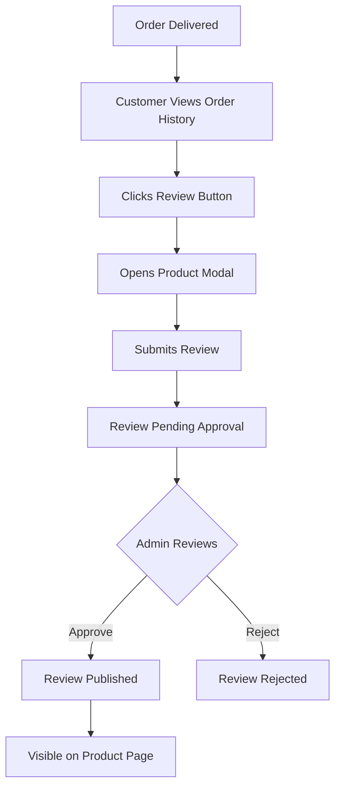

## 1. Product Overview

This document outlines the requirements for implementing a comprehensive user review system for the restaurant ordering platform. The system enables customers to leave reviews for products they've ordered, with admin approval workflow and detailed review display functionality.

The review system solves the problem of building customer trust and providing valuable feedback to the restaurant. Customers can share their experiences with specific dishes, while restaurant management can moderate reviews before they appear publicly. This helps maintain quality control and build a reliable review ecosystem.

## 2. Core Features

### 2.1 User Roles

| Role | Registration Method | Core Permissions |
|------|---------------------|------------------|
| Customer | Email registration | Can submit reviews for delivered orders, view all approved reviews |
| Admin | Manual setup | Can approve/reject pending reviews, view all reviews |
| Guest | No registration | Can view approved reviews only |

### 2.2 Feature Module

The review system consists of the following main pages and components:

1. **Product Detail Page**: Product information, reviews tab, review submission form
2. **Order History Page**: Order details with review buttons for delivered orders
3. **Admin Review Management**: Pending reviews list with approval/rejection functionality

### 2.3 Page Details

| Page Name | Module Name | Feature description |
|-----------|-------------|---------------------|
| Product Detail | Review Display Section | Show approved reviews with user info, rating stars, review text, and ordered products dropdown |
| Product Detail | Review Submission Form | Modal form with star rating (1-5), text review input, and submit functionality |
| Product Detail | Review Status Check | Verify if user can review based on order history and delivery status |
| Order History | Review Button | Display "Bewertung schreiben" button only for delivered orders |
| Order History | Review Trigger | Open product detail modal with review form when clicked |
| Admin Dashboard | Pending Reviews List | Display all pending reviews with user and product information |
| Admin Dashboard | Review Approval | Approve or reject reviews with status update functionality |

## 3. Core Process

### Customer Review Flow
1. Customer places order and order status becomes "delivered"
2. Customer navigates to Order History page
3. Customer clicks "Bewertung schreiben" button next to delivered order items
4. Product detail modal opens with review form
5. Customer submits star rating and text review
6. Review goes to pending status for admin approval
7. Once approved, review appears on product page

### Admin Approval Flow
1. Admin accesses review management dashboard
2. Views list of pending reviews with user and product details
3. Reviews each submission for appropriateness
4. Approves or rejects the review
5. Approved reviews become visible to all users

## 4. User Interface Design

### 4.1 Design Style
- **Primary Colors**: Creamy background with spicy accent colors (matching existing theme)
- **Button Style**: Rounded corners with hover effects using Tailwind classes
- **Font**: Poppins for headings, Roboto for body text (German language support)
- **Layout**: Card-based design with proper spacing and shadows
- **Icons**: Lucide React icons for consistency
- **Rating Display**: 5-star system with filled/unfilled star icons

### 4.2 Page Design Overview

| Page Name | Module Name | UI Elements |
|-----------|-------------|-------------|
| Product Detail | Review Tab | Tab navigation with "Produkt" and "Bewertungen" sections, review count badge |
| Product Detail | Review List | User avatar, name, star rating, review text, expandable product list, timestamp |
| Product Detail | Review Form | Modal with star rating selector, textarea for review text, submit/cancel buttons |
| Order History | Review Button | Small outline button with message icon, German text "Bewertung schreiben" |
| Admin Dashboard | Review Cards | Compact cards showing user info, product details, review content, approve/reject buttons |

### 4.3 Responsiveness
- **Desktop-First**: Optimized for desktop viewing with proper layout
- **Mobile-Adaptive**: Responsive design that works on tablets and phones
- **Touch Optimization**: Proper button sizes and spacing for mobile interaction
- **Modal Handling**: Full-screen modals on mobile, centered on desktop