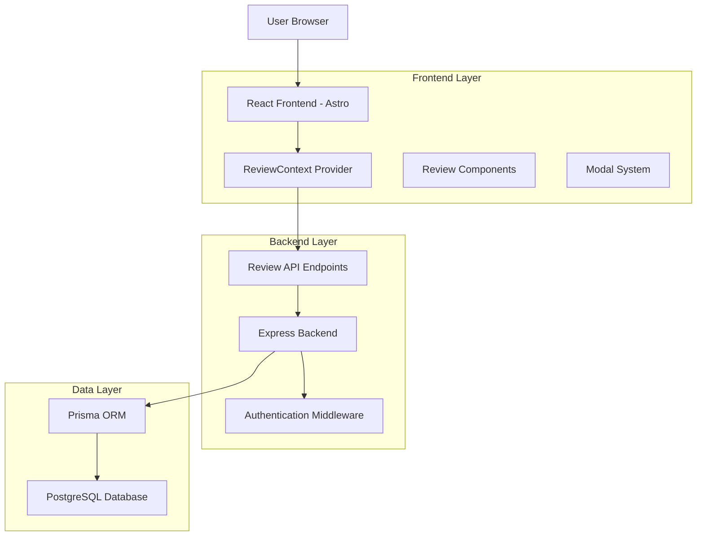
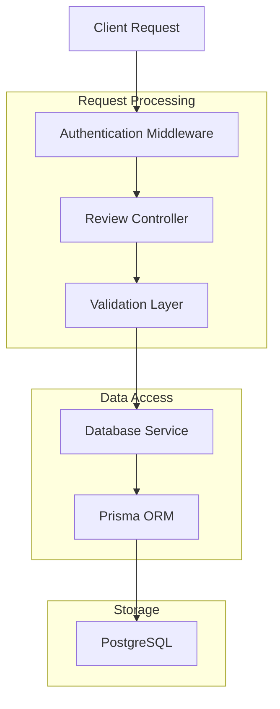
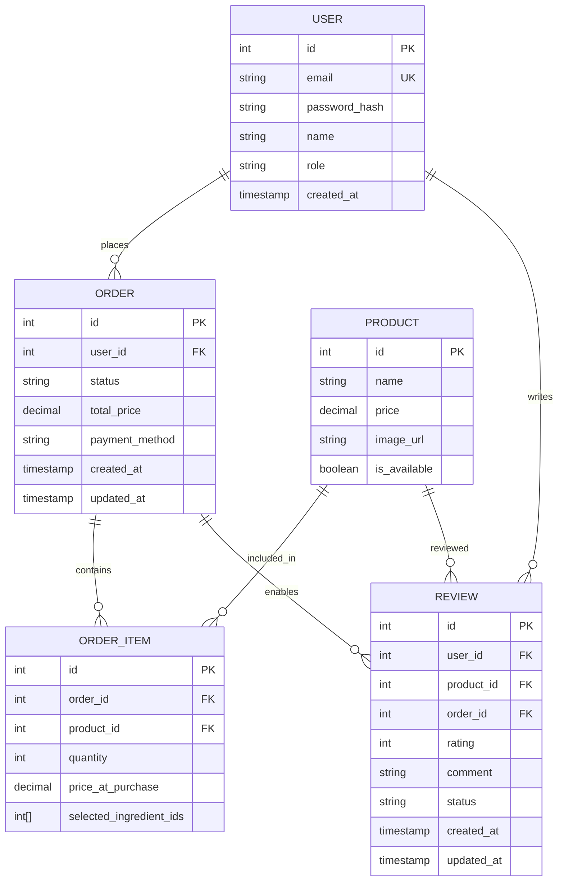

## 1. Architecture Design



## 2. Technology Description

- **Frontend**: React@18 + Astro + TailwindCSS@3 + shadcn/ui
- **Backend**: Node.js + Express@4 + Prisma
- **Database**: PostgreSQL (via Supabase)
- **Authentication**: JWT tokens with middleware protection
- **State Management**: React Context API (ReviewContext)
- **UI Components**: shadcn/ui components (Dialog, Button, Card, etc.)

## 3. Route Definitions

| Route | Purpose |
|-------|---------|
| `/api/reviews/product/:productId` | Get approved reviews for a specific product |
| `/api/reviews` | Submit new review (POST) |
| `/api/reviews/can-review/:productId` | Check if user can review a product |
| `/api/reviews/pending` | Get all pending reviews (admin only) |
| `/api/reviews/:reviewId/approve` | Approve a review (admin only) |
| `/api/reviews/:reviewId/reject` | Reject a review (admin only) |

## 4. API Definitions

### 4.1 Review Submission
```
POST /api/reviews
```

Request:
| Param Name | Param Type | isRequired | Description |
|------------|------------|------------|-------------|
| productId | number | true | ID of the product being reviewed |
| rating | number | true | Star rating (1-5) |
| comment | string | true | Review text content |
| orderedProducts | array | true | List of products from the order |

Response:
| Param Name | Param Type | Description |
|------------|------------|-------------|
| success | boolean | Operation status |
| review | object | Created review data |
| message | string | Success/error message |

### 4.2 Get Product Reviews
```
GET /api/reviews/product/:productId
```

Response:
| Param Name | Param Type | Description |
|------------|------------|-------------|
| reviews | array | List of approved reviews |
| totalCount | number | Total number of reviews |

### 4.3 Check Review Eligibility
```
GET /api/reviews/can-review/:productId
```

Response:
| Param Name | Param Type | Description |
|------------|------------|-------------|
| canReview | boolean | Whether user can submit review |
| hasOrdered | boolean | If user has ordered the product |
| isDelivered | boolean | If order status is delivered |
| existingReview | boolean | If user already reviewed |

### 4.4 Admin Review Management
```
GET /api/reviews/pending
```

Response:
| Param Name | Param Type | Description |
|------------|------------|-------------|
| reviews | array | List of pending reviews |
| totalCount | number | Total pending reviews |

```
PUT /api/reviews/:reviewId/approve
PUT /api/reviews/:reviewId/reject
```

## 5. Server Architecture Diagram



## 6. Data Model

### 6.1 Database Schema



### 6.2 Database Tables

**Reviews Table**
```sql
CREATE TABLE reviews (
    id SERIAL PRIMARY KEY,
    user_id INTEGER NOT NULL REFERENCES users(id) ON DELETE CASCADE,
    product_id INTEGER NOT NULL REFERENCES products(id) ON DELETE CASCADE,
    order_id INTEGER NOT NULL REFERENCES orders(id) ON DELETE CASCADE,
    rating INTEGER NOT NULL CHECK (rating >= 1 AND rating <= 5),
    comment TEXT NOT NULL,
    status VARCHAR(20) NOT NULL DEFAULT 'pending' CHECK (status IN ('pending', 'approved', 'rejected')),
    created_at TIMESTAMP WITH TIME ZONE DEFAULT NOW(),
    updated_at TIMESTAMP WITH TIME ZONE DEFAULT NOW()
);

-- Indexes for performance
CREATE INDEX idx_reviews_product_id ON reviews(product_id);
CREATE INDEX idx_reviews_user_id ON reviews(user_id);
CREATE INDEX idx_reviews_status ON reviews(status);
CREATE INDEX idx_reviews_created_at ON reviews(created_at DESC);

-- Unique constraint to prevent duplicate reviews
CREATE UNIQUE INDEX idx_unique_user_product_review ON reviews(user_id, product_id);
```

**Order Items Table Enhancement**
```sql
-- Add support for review tracking if needed
ALTER TABLE order_items 
ADD COLUMN IF NOT EXISTS review_id INTEGER REFERENCES reviews(id);
```

### 6.3 Initial Data Setup

```sql
-- Grant permissions for review operations
GRANT SELECT, INSERT, UPDATE ON reviews TO authenticated;
GRANT SELECT ON reviews TO anon;

-- Sample review data for testing
INSERT INTO reviews (user_id, product_id, order_id, rating, comment, status) VALUES
(1, 1, 1, 5, 'Ausgezeichnetes Gericht! Sehr zu empfehlen.', 'approved'),
(2, 1, 2, 4, 'Guter Geschmack, könnte etwas würziger sein.', 'approved'),
(3, 2, 3, 5, 'Perfekte Zubereitung und tolle Präsentation.', 'pending');
```

## 7. Component Architecture

### 7.1 ReviewContext Structure
```typescript
interface ReviewContextType {
  reviews: Review[];
  loading: boolean;
  error: string | null;
  fetchProductReviews: (productId: number) => Promise<void>;
  submitReview: (reviewInput: ReviewInput) => Promise<void>;
  canUserReview: (productId: number) => Promise<CanReviewResponse>;
}
```

### 7.2 Key Components
- **ReviewProvider**: Context provider for review state management
- **ReviewSection**: Displays list of reviews with loading states
- **ReviewCard**: Individual review display component
- **ReviewFormModal**: Modal for submitting new reviews
- **Review Integration**: Embedded in ProductDetail and OrderHistoryPage

## 8. Security Considerations

- **Authentication Required**: All review operations require valid JWT token
- **Order Validation**: Users can only review products from delivered orders
- **Review Limits**: One review per user per product (enforced at database level)
- **Admin Authorization**: Admin operations require admin role validation
- **Input Validation**: Server-side validation for all review inputs
- **XSS Protection**: Sanitization of review text content